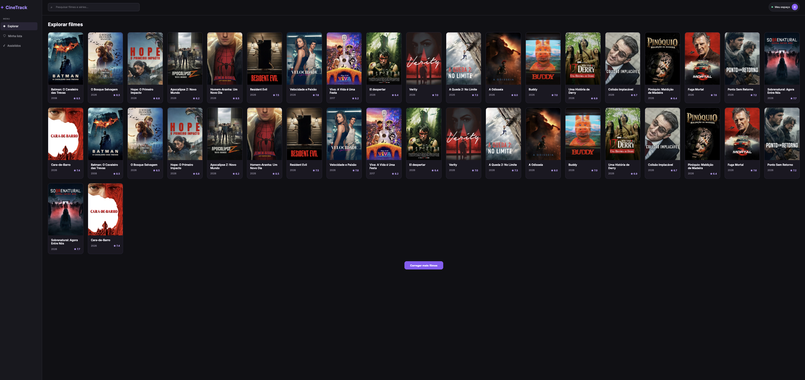

# 🎬 CineTrack

**Explore filmes, descubra novas histórias e organize seus favoritos e assistidos.**

[Ver demonstração](https://cinetrack-blush.vercel.app/) · [Funcionalidades](#-funcionalidades-implementadas) · [Como executar](#️-como-executar-o-projeto)

O **CineTrack** é uma aplicação web desenvolvida com React que permite explorar filmes populares, pesquisar títulos, filtrar filmes por gênero, visualizar informações detalhadas, criar uma lista personalizada de favoritos e acompanhar os filmes já assistidos, utilizando dados reais da API do The Movie Database (TMDB).

O projeto foi desenvolvido para colocar em prática conceitos de desenvolvimento Front-end, como componentização, gerenciamento e compartilhamento de estados, consumo de APIs REST, navegação entre páginas, persistência de dados, filtros dinâmicos, programação assíncrona e construção de interfaces responsivas.

## 📸 Preview do projeto



🌐 **[Acesse o projeto online](https://cinetrack-blush.vercel.app/)**

## 🚀 Tecnologias utilizadas

- **React** — construção de interfaces com componentes reutilizáveis.
- **JavaScript (ES6+)** — lógica da aplicação e programação assíncrona.
- **React Router DOM** — navegação entre páginas, rotas dinâmicas e parâmetros de URL.
- **HTML5** — estrutura semântica da aplicação.
- **CSS3** — estilização, Flexbox, CSS Grid e responsividade.
- **Vite** — ambiente de desenvolvimento e build.
- **TMDB API** — integração com dados reais de filmes.
- **LocalStorage** — persistência dos filmes favoritos e assistidos no navegador.

## ✨ Funcionalidades implementadas

### 🎥 Exploração de filmes

- Listagem de filmes populares utilizando a API do TMDB.
- Pesquisa de filmes por título.
- Exibição de pôsteres, títulos, anos de lançamento e avaliações.
- Paginação com botão **Carregar mais filmes**.
- Carregamento incremental de filmes.
- Mensagens para pesquisas sem resultados.
- Indicadores de carregamento e tratamento básico de erros.
- Pesquisa otimizada com debounce de 500 ms, reduzindo requisições desnecessárias à API.

### 🎭 Filtros por gênero

- Seleção de filmes por gênero através de um menu interativo.
- Gêneros disponíveis: Terror, Comédia, Romance, Ficção científica e Drama.
- Opção para visualizar filmes de todos os gêneros.
- Busca de filmes diretamente na API TMDB utilizando o endpoint `/discover/movie`.
- Integração do filtro com a paginação.
- Reinicialização da paginação ao selecionar outro gênero.
- Persistência do gênero selecionado nos parâmetros da URL utilizando `useSearchParams()`.
- Preservação do filtro ao navegar para os detalhes de um filme e retornar pelo histórico.
- Atualização automática da listagem ao alterar o gênero.
- Tratamento de requisições assíncronas para evitar que respostas antigas substituam os resultados atuais.
- Reinicialização dos resultados e controle do estado de carregamento ao iniciar novas buscas.

### 🎬 Detalhes dos filmes

- Página individual de detalhes para cada filme.
- Navegação dinâmica utilizando React Router.
- Exibição de sinopse, gêneros, duração e avaliação.
- Botão para retornar à página anterior utilizando `useNavigate()`.
- Exibição dos 6 primeiros integrantes do elenco principal.
- Fotos dos atores, nomes e personagens interpretados.
- Integração com o endpoint `/movie/{id}/credits` da TMDB.
- Layout do elenco organizado com CSS Grid.

### ❤️ Sistema de favoritos

- Adição e remoção de filmes favoritos diretamente nos cards.
- Persistência dos favoritos utilizando LocalStorage.
- Página **Minha lista** com os filmes favoritados.
- Remoção de favoritos diretamente da página Minha lista.
- Consulta dos dados completos dos favoritos através da API do TMDB.
- Navegação para os detalhes dos filmes.
- Mensagem personalizada quando a lista está vazia.
- Indicador de carregamento dos filmes favoritos.
- Compartilhamento do estado de favoritos entre páginas.

### ✅ Sistema de filmes assistidos

- Marcação de filmes como assistidos diretamente nos cards.
- Alternância entre os estados **Marcar como assistido** e **Assistido**.
- Página dedicada aos filmes assistidos.
- Remoção de filmes diretamente da lista de assistidos.
- Persistência dos filmes assistidos utilizando LocalStorage.
- Consulta dos detalhes dos filmes assistidos através da API do TMDB.
- Exibição da quantidade total de filmes assistidos.
- Mensagem personalizada quando não há filmes assistidos.
- Indicador de carregamento durante as requisições.
- Compartilhamento do estado de assistidos entre páginas.

### 🧭 Navegação e interface

- Sidebar com navegação entre **Explorar**, **Minha lista** e **Assistidos**.
- Destaque automático da página ativa utilizando `useLocation()`.
- Contadores dinâmicos de filmes favoritos e assistidos.
- Atualização automática dos contadores ao adicionar ou remover filmes.
- Interface em tema escuro com detalhes em roxo.
- Seletor de gêneros estilizado com efeitos de hover, focus e transições.
- Layout responsivo na página de detalhes.
- Organização em componentes, páginas e serviços.

## 🛠️ Próximas funcionalidades

O CineTrack continua em desenvolvimento. As próximas melhorias previstas são:

### Funcionalidades concluídas

- [x] Implementar uma lista de filmes favoritos.
- [x] Salvar favoritos utilizando LocalStorage.
- [x] Criar uma página dedicada aos filmes favoritos.
- [x] Permitir remover favoritos diretamente da página Minha lista.
- [x] Exibir uma mensagem personalizada quando não houver favoritos.
- [x] Criar uma lista de filmes assistidos.
- [x] Permitir marcar e desmarcar filmes como assistidos.
- [x] Persistir filmes assistidos no LocalStorage.
- [x] Criar uma página dedicada aos filmes assistidos.
- [x] Implementar navegação com destaque da página ativa.
- [x] Adicionar contadores dinâmicos na Sidebar.
- [x] Implementar filtro de filmes por gênero.
- [x] Integrar a busca por gênero diretamente à API TMDB.
- [x] Integrar a paginação aos filtros por gênero.
- [x] Preservar o gênero selecionado nos parâmetros da URL.
- [x] Evitar que respostas antigas substituam resultados de buscas recentes.
- [x] Adicionar filtros por gênero e avaliação.
- [x] Melhorar a experiência de busca com debounce.
- [x] Exibir elenco principal dos filmes.

### Melhorias planejadas

- [ ] Criar uma lista de filmes para assistir posteriormente.
- [ ] Aprimorar a responsividade das demais telas.
- [ ] Adicionar estados visuais de carregamento (skeletons).
- [ ] Aprimorar o tratamento de erros nas páginas de favoritos e assistidos.
- [ ] Aprimorar a acessibilidade da interface.

## 📚 Conceitos praticados

Durante o desenvolvimento, foram trabalhados:

### React e componentização

- Componentes funcionais e props.
- Hooks `useState` e `useEffect`.
- Gerenciamento e compartilhamento de estados entre componentes.
- **Lifting State Up** — elevação do estado para um componente pai.
- Fluxo de dados entre componentes pais e filhos.
- Passagem de funções como props.
- Renderização condicional.
- Renderização de listas com `.map()`.
- Atualização automática da interface a partir de mudanças de estado.

### React Router

- Navegação com `useNavigate()`.
- Identificação da rota atual com `useLocation()`.
- Parâmetros dinâmicos com `useParams()`.
- Gerenciamento de parâmetros de URL com `useSearchParams()`.
- Configuração de rotas com `BrowserRouter`, `Routes` e `Route`.
- Navegação declarativa utilizando `Link`.
- Preservação de filtros através de parâmetros de URL.
- Navegação pelo histórico com `navigate(-1)`.

### JavaScript

- Manipulação de arrays com `.map()`, `.filter()`, `.includes()` e spread operator.
- Manipulação de objetos e acesso às suas propriedades.
- Operadores lógicos `&&`, `||` e `!`.
- Operadores ternários e condições encadeadas.
- Conversão de strings para números com `Number()`.
- Parâmetros com valores padrão em funções.
- Template literals para construção dinâmica de URLs.
- Eventos e controle de propagação com `event.stopPropagation()`.
- Manipulação de arrays com `.slice()`.
- Temporizadores com `setTimeout()` e `clearTimeout()`.

### APIs e programação assíncrona

- Requisições HTTP com `fetch()`.
- Programação assíncrona com `async/await`.
- Consumo de endpoints REST.
- Leitura de respostas JSON com `response.json()`.
- Verificação de respostas HTTP com `response.ok`.
- Tratamento de erros com `try/catch/finally`.
- Execução de múltiplas requisições com `Promise.all()`.
- Paginação de resultados.
- Filtragem de dados diretamente na API utilizando parâmetros de consulta.
- Gerenciamento de dependências do `useEffect`.
- Funções de limpeza (_cleanup_) do `useEffect`.
- Controle de respostas assíncronas desatualizadas.
- Gerenciamento de estados de carregamento e erro.
- Integração com múltiplos endpoints da API TMDB.
- Otimização de pesquisas com debounce.

### Persistência e organização

- Persistência de dados com `localStorage`.
- Serialização e desserialização com `JSON.stringify()` e `JSON.parse()`.
- Variáveis de ambiente com Vite.
- Separação de responsabilidades entre componentes, páginas e serviços.
- Organização de funções reutilizáveis para consumo da API.

### CSS e interface

- Layouts com Flexbox e CSS Grid.
- Media queries e responsividade.
- Pseudoclasses `:hover` e `:focus`.
- Transições com `transition`.
- Classes CSS dinâmicas.
- Estilização de formulários e seletores.
- Controle de proporção de imagens com `aspect-ratio` e `object-fit`.

## 📁 Estrutura do projeto

```text
cinetrack/
├── src/
│   ├── components/
│   │   ├── Header.jsx
│   │   ├── Sidebar.jsx
│   │   └── MovieCard.jsx
│   ├── pages/
│   │   ├── HomePage.jsx
│   │   ├── FavoritesPage.jsx
│   │   ├── WatchedPage.jsx
│   │   └── MovieDetailsPage.jsx
│   ├── services/
│   │   └── tmdb.js
│   ├── screenshots/
│   │   └── cinetrack.png
│   ├── App.jsx
│   └── main.jsx
├── styles/
│   ├── App.css
│   ├── Header.css
│   ├── Sidebar.css
│   ├── MovieCard.css
│   ├── MovieDetailsPage.css
│   └── index.css
├── .env.local
├── package.json
└── README.md
```

## ⚙️ Como executar o projeto

### 1. Clone o repositório

```bash
git clone https://github.com/isahlbbh/cinetrack.git
cd cinetrack
```

### 2. Instale as dependências

```bash
npm install
```

### 3. Configure a API do TMDB

Crie um arquivo `.env.local` na raiz do projeto:

```env
VITE_TMDB_API_KEY=SUA_CHAVE_DA_API
```

Você pode obter uma chave de API no site do [TMDB](https://www.themoviedb.org/).

### 4. Inicie o servidor de desenvolvimento

```bash
npm run dev
```

Abra no navegador o endereço local informado pelo Vite.

**Observação:** variáveis com o prefixo `VITE_` são incorporadas ao código do navegador e não devem ser consideradas secretas. Credenciais privadas devem ser protegidas em um backend.

## 🎯 Objetivo do projeto

O CineTrack faz parte do meu processo de aprendizado e evolução como desenvolvedora Front-end.

Meu objetivo é desenvolver uma aplicação que vá além de uma interface estática, trabalhando com dados reais, interações, navegação, persistência de informações, filtros dinâmicos, organização de código e resolução de problemas encontrados durante o desenvolvimento.

A implementação dos sistemas de favoritos e filmes assistidos permitiu aprofundar meus conhecimentos em gerenciamento de estados, compartilhamento de dados entre componentes, armazenamento local, manipulação de arrays e requisições assíncronas.

O desenvolvimento dos filtros por gênero representou uma nova etapa do projeto, envolvendo a integração com endpoints específicos da API TMDB, gerenciamento de parâmetros de URL, paginação dinâmica e controle de requisições assíncronas.

Durante essa implementação, também pratiquei o uso de funções de limpeza do `useEffect`, compreendendo como evitar que respostas de requisições antigas interfiram nos resultados atuais.

O desenvolvimento dos contadores dinâmicos e da navegação com destaque automático contribuiu para compreender melhor o fluxo de dados no React e a atualização da interface a partir das mudanças de estado.

Cada funcionalidade representa uma oportunidade de desenvolver autonomia, aprimorar meu raciocínio lógico e consolidar meus conhecimentos em React, JavaScript e boas práticas de desenvolvimento web.

O projeto continuará recebendo melhorias conforme novos conhecimentos forem adquiridos.

## 🎞️ Créditos

Este produto utiliza a API do TMDB, mas não é endossado nem certificado pelo TMDB.

Dados e imagens de filmes fornecidos por [The Movie Database (TMDB)](https://www.themoviedb.org/).

---

**Desenvolvido com 💜 e React.**
